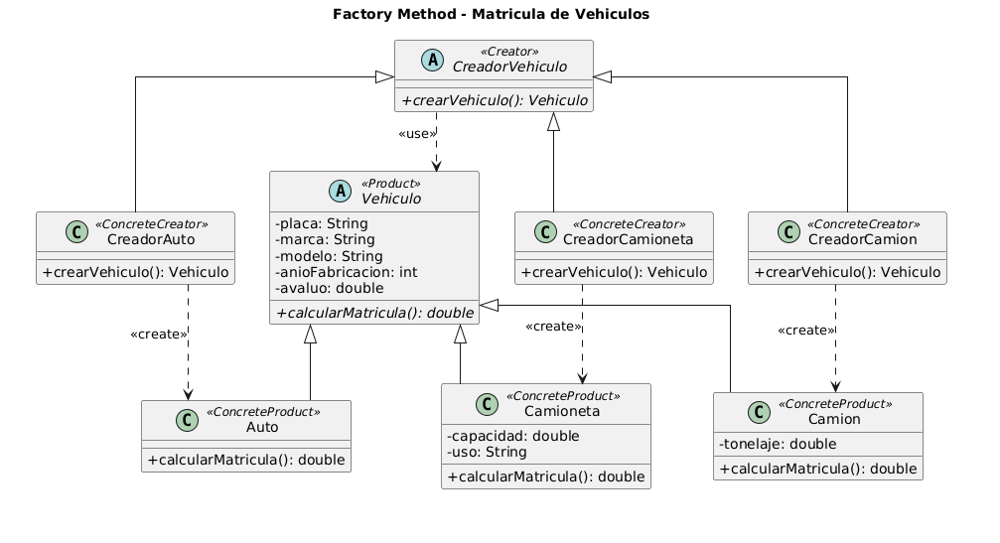
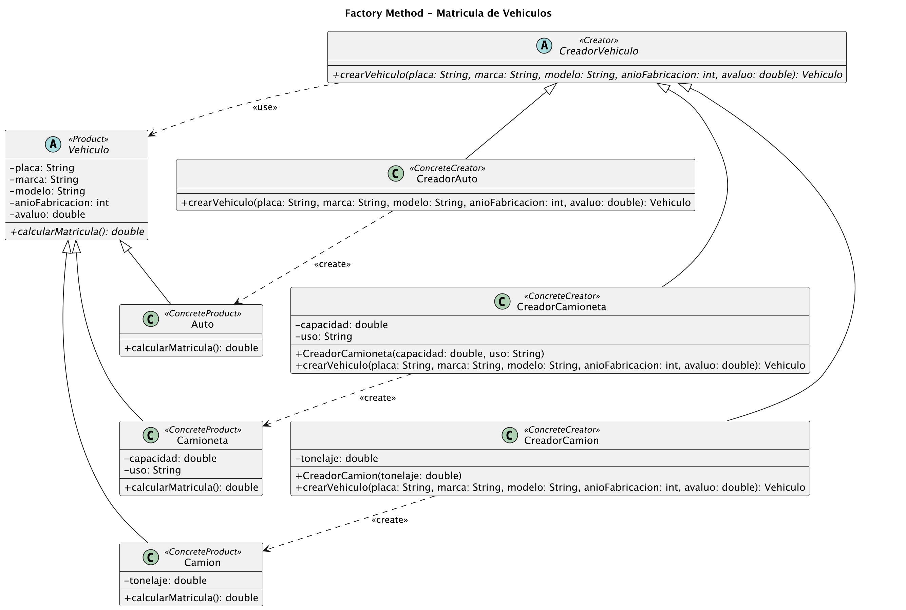
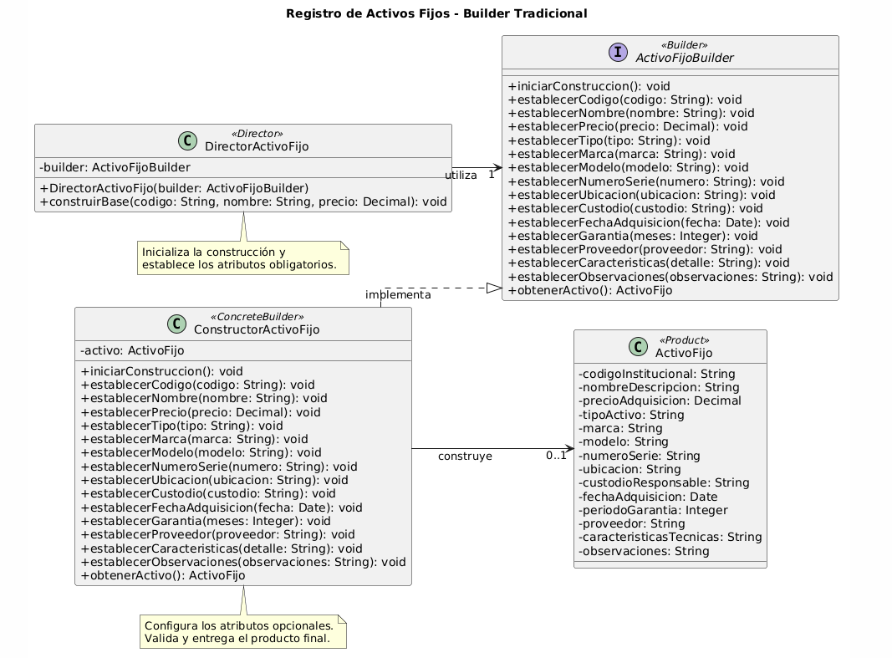
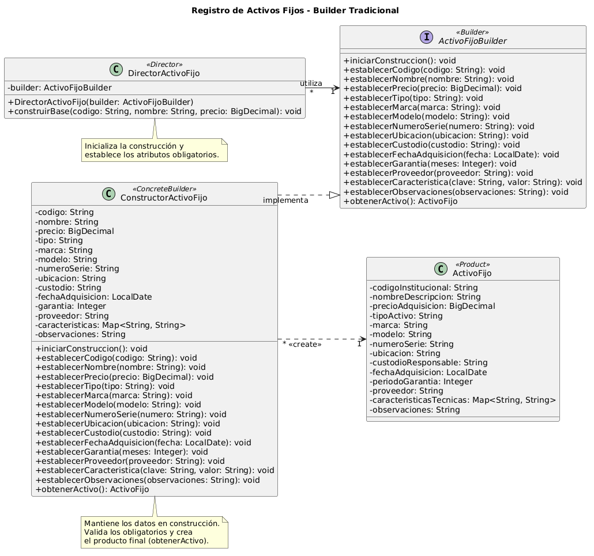

**<u>Escenario 1:</u>**

1.  Identificación del problema.

**Problema:** La empresa tiene que registrar diferentes tipos de vehículos y calcular el valor correspondiente a su matrícula. El sistema trabaja con tres tipos de vehículos:

- Auto.
- Camioneta.
- Camión.
- Su idea es expandir a nuevos vehículos a futuro

Aunque comparten características generales, cada tipo posee particularidades que afectan el cálculo de su matrícula. El problema principal no es únicamente calcular ese valor, sino cómo crear diferentes tipos de objetos durante la EJECUCIÓN (Una palabra clave que nos indica que patrón de diseño se debe aplicar) sin que la lógica principal dependa directamente de sus clases concretas.

**Requisitos:** Los requisitos funcionales identificados en el enunciado son:

- Registrar vehículos de tipo Auto, Camioneta y Camión.
- Almacenar placa, marca, modelo, año de fabricación y avalúo.
- Permitir una operación para calcular el valor de la matrícula.
- Aplicar una lógica de cálculo especifica según el tipo de vehículo. (Nos da ejemplos de cómo se calcula según el tipo).
- Permitir seleccionar el tipo de vehículo durante la ejecución.
- Permitir que el proceso trabaje con un contrato común de vehículo, no por el tipo.

Los requisitos de diseño son:

- Evitar que la lógica principal dependa de las clases concretas Auto, Camioneta y Camión.
- Centralizar las responsabilidades de creación en componentes especializados.
- Facilitar la incorporación de nuevos tipos de vehículos.
- Favorecer el polimorfismo para operar con diferentes vehículos.

**Clases identificadas:** Las entidades identificadas mediante el enunciado son:

- Vehículo
- Auto
- Camioneta
- Camión
- Cliente

2.  Seleccionar y justificar el patrón creacional correspondiente

El patrón seleccionado para resolver este problema es Factory Method, ya que permite crear diferentes tipos de objetos sin que la clase que los utiliza tenga que conocer directamente como se construye, es decir se define un método que permite crear objetos haciendo que las subclases decidan que tipo de objeto se desea crear.

| Ventajas                                                         | Limitaciones                                                  |
|--------------------------------------------------------------------|---------------------------------------------------------------|
| Evita crear directamente los vehículos en la lógica principal.     | Es necesario crear clases adicionales.                        |
| Permite manejar los vehículos mediante una clase o interfaz común. | El diseño inicial es un poco más extenso.                     |
| Facilita agregar nuevos tipos de vehículos.                        | Se necesita un creador específico para cada tipo de vehículo. |
| Organiza la responsabilidad de crear los objetos.                  | Hay que decidir cómo seleccionar el creador adecuado.         |

Tendremos que añadir a los cuatro principales participantes del factory method:

| Participante   | Clase propuesta                              |
|------------------|----------------------------------------------|
| Product          | Vehículo                                     |
| ConcreteProduct  | Auto, Camioneta, Camión                      |
| Creator          | CreadorVehiculo                              |
| ConcreteCreator  | CreadorAuto, CreadorCamioneta, CreadorCamion |

3.  Diagrama de clases UML

4.  Código fuente

El código está en `codigo-escenario-1/` (Java 17+, paquete `vehiculos`). Correspondencia con el diagrama:

| Participante    | Clase                                              |
|-----------------|----------------------------------------------------|
| Product         | `vehiculos.producto.Vehiculo`                      |
| ConcreteProduct | `Auto`, `Camioneta`, `Camion`                      |
| Creator         | `vehiculos.creador.CreadorVehiculo`                |
| ConcreteCreator | `CreadorAuto`, `CreadorCamioneta`, `CreadorCamion` |
| Cliente         | `vehiculos.Main`                                   |

5.  Uso crítico de inteligencia artificial

Link del análisis: <https://chatgpt.com/share/6ac9002d-c300-83e8-9d1d-4868c9909a5b>

**Prompt principal:**

Actúa como un asistente especializado en patrones de diseño de software y modelado UML.

Estoy desarrollando una actividad académica sobre patrones creacionales. Para el primer escenario he seleccionado el patrón **Factory Method** y ya realicé un análisis previo del problema.

**Objetivo:**

Necesito que revises mi análisis y me ayudes a elaborar una propuesta de diagrama de clases UML utilizando Factory Method.

**Instrucciones:**

1.  Revisa el enunciado original y compáralo con mi análisis para identificar posibles errores, requisitos faltantes o aspectos que deban aclararse.
2.  Evalúa si la selección de Factory Method es adecuada para resolver el problema e indica brevemente por qué.
3.  Propón las clases necesarias para aplicar el patrón, utilizando su estructura tradicional: Product, ConcreteProduct, Creator y ConcreteCreator.
4.  Identifica los atributos y métodos principales de cada clase, considerando únicamente los requisitos del escenario.
5.  Explica las relaciones que deben existir entre las clases y el tipo de relación UML que corresponde.
6.  Genera una propuesta de diagrama de clases UML utilizando PlantUML.
7.  Justifica brevemente las principales decisiones del diseño.
8.  Identifica posibles limitaciones o aspectos que podrían mejorarse.

**Consideraciones:**

- Utiliza un lenguaje sencillo, ya que estamos aprendiendo patrones de diseño.
- No agregues clases o funcionalidades innecesarias.
- Respeta la estructura de Factory Method explicada en el material académico.
- No inventes requisitos que no estén presentes en el enunciado. Si necesitas asumir algo, indícalo claramente.
- No generes código de implementación todavía.
- Considera el diagrama como una propuesta que debe ser revisada antes de su implementación.

**Enunciado original:**

…

**Mi análisis previo:**

…

**RECOMENDACIONES DE LA IA**

| Apartado               | Decisión                                                                                                            |
|--------------------------|---------------------------------------------------------------------------------------------------------------------|
| Recomendación aceptada   | Utilizar Vehículo como clase abstracta. Recomendado mediante la IA y también propuesta dentro del análisis inicial. |
| Recomendación modificada | Cambiar el método de crearVehiculo() para recibir los atributos comunes.                                            |

Se acepta que `Vehiculo` sea una clase abstracta porque todos los vehículos comparten placa, marca, modelo, año de fabricación y avalúo, y cada tipo debe implementar su propia lógica de `calcularMatricula()` bajo un contrato común; así la lógica principal trabaja con `Vehiculo` sin depender de Auto, Camioneta o Camión. Además, coincidía con lo planteado en el análisis inicial.

Mediante la explicación de la IA, el diagrama, las clases inferidas y las relaciones del Factory Method fueron correctas. En cuanto a la modificación en el método crearVehiculo() es debido a que consideramos necesario que este método reciba los atributos comunes, como placa, marca, modelo, año de fabricación y avalúo, para que cada vehículo pueda crearse con su información correspondiente, la modificación facilita el registro de los vehículos y mantiene la estructura del patrón Factory Method.

**Ajustes realizados durante la implementación (Escenario 1):**

| Cambio | Justificación |
|--------|---------------|
| Se agregaron `validarNoNegativo()` y `antiguedad()` como métodos protegidos en `Vehiculo`. | Evitan repetir validaciones y el cálculo de antigüedad en cada subclase. No alteran el contrato público del diagrama. |
| Se agregaron validaciones en los constructores (placa obligatoria, año de fabricación ≥ 1900, valores no negativos). | El enunciado exige atributos válidos para calcular la matrícula; así no se crean vehículos inconsistentes. |
| Los atributos `capacidad`, `uso` y `tonelaje` se declararon `final`. | Un vehículo no debe cambiar sus datos tras su creación. |
| Se agregaron getters y `toString()`. | Permiten mostrar el vehículo creado en la consola. |
| Se definieron fórmulas de matrícula académicas: Auto = 2 % del avalúo + 1 % del avalúo por año de antigüedad (este recargo llega como máximo al 10 %); Camioneta = 3 % del avalúo + 20 por tonelada de capacidad, con +15 % sobre el total si el uso es comercial; Camión = 4 % del avalúo + 50 por tonelada. | El enunciado solo da criterios generales, por lo que son un **supuesto** del grupo. |
| Se agregó `Main.java` con un menú que selecciona el creador según el tipo elegido y solicita sus datos. | Demuestra que, tras elegir el creador, el resto del proceso solo usa `CreadorVehiculo` y `Vehiculo`. |

**<u>Escenario 2:</u>**

1.  Identificación del problema.

**Problema:** Se necesita desarrollar un sistema para registrar activos fijos, como computadoras, monitores, impresoras, muebles, vehículos y otros bienes institucionales. Cada activo contiene información obligatoria como código institucional, nombre o descripción y precio de adquisición, además también pueden contener información adicional dependiendo del tipo de activo y no todos los activos poseen los mismos datos adicionales.

El problema surge en como crear objetos si tienen numerosos atributos y algunos obligatorios y otros opcionales (Pista para identificar el patrón de diseño que se debe implementar). Por esa razón se necesita permitir que los activos puedan construirse progresivamente utilizando los atributos que corresponde a cada tipo.

**Requisitos:** Los requisitos funcionales identificados en el enunciado son:

- Registrar diferentes tipos de activos institucionales.
- Registrar obligatoriamente atributos como código institucional, nombre o descripción y precio de adquisición.
- Registrar atributos opcionales según el tipo de activo y construir los activos progresivamente.

Los requisitos de diseño identificados son:

- Evitar el uso de múltiples constructores con diferentes combinaciones de parámetros.
- Evitar tener que proporcionar valores vacíos o null para atributos que no corresponden al activo.
- Mantener un proceso de construcción claro y fácil de comprender.
- Separar la construcción progresiva del activo de su representación final.

**Clases identificadas:** Las entidades identificadas mediante el enunciado son

- Activo Fijo
- Computador
- Monitor
- Impresora
- Mueble
- Vehículo

**Atributos identificados:**

Atributos obligatorios:

- Código institucional.
- Nombre o descripción.
- Precio de adquisición.

Atributos opcionales:

- Marca.
- Modelo.
- Número de serie.
- Ubicación.
- Custodio responsable.
- Fecha de adquisición.
- Período de garantía.
- Proveedor.
- Características técnicas.
- Observaciones.

2.  Seleccionar y justificar el patrón creacional correspondiente

El patrón seleccionado para resolver este problema es Builder, ya que permite construir objetos paso a paso, separando el proceso de construcción del objeto final. En este caso, los activos fijos tienen atributos obligatorios y opcionales, por lo que Builder permite establecer primero la información necesaria y agregar después las características que corresponden a cada activo, evitando utilizar constructores con demasiados parámetros.

| Ventajas                                                      | Limitaciones                                                        |
|-----------------------------------------------------------------|---------------------------------------------------------------------|
| Permite construir los activos fijos paso a paso.                | Es necesario crear clases adicionales para manejar la construcción. |
| Facilita el manejo de atributos obligatorios y opcionales.      | El diseño inicial puede ser un poco más extenso.                    |
| Evita utilizar constructores con demasiados parámetros.         | Se debe controlar que los atributos obligatorios estén presentes.   |
| Permite crear activos con diferentes configuraciones.           | Puede resultar innecesario para objetos que tienen pocos atributos. |
| Hace que la creación de los objetos sea más clara y organizada. | Requiere definir los pasos o métodos para construir el objeto.      |

Tenemos que manejar las siguientes clases principales para diseñar según el patrón tradicional de Builder:

| Participante   | Clase propuesta              |
|------------------|------------------------------|
| Product          | ActivoFijo                   |
| Builder          | ActivoFijoBuilder (interfaz) |
| ConcreteBuilder  | ConstructorActivoFijo        |
| Director         | DirectorActivoFijo           |

3.  Diagrama de clases UML

4.  Código fuente

El código está en `codigo-escenario-2/` (Java 17+, paquete `activos`). Correspondencia con el diagrama:

| Participante    | Clase                                        |
|-----------------|----------------------------------------------|
| Product         | `activos.construccion.ActivoFijo`            |
| Builder         | `activos.construccion.ActivoFijoBuilder`     |
| ConcreteBuilder | `activos.construccion.ConstructorActivoFijo` |
| Director        | `activos.construccion.DirectorActivoFijo`    |
| Cliente         | `activos.Main`                               |

5.  Uso crítico de inteligencia artificial

Link del análisis: <https://chatgpt.com/share/6ac90712-ac80-83e9-a6c9-04948b7a77bd>

**Prompt principal:**

Actúa como un asistente especializado en patrones de diseño de software y modelado UML.

Estoy desarrollando una actividad académica sobre patrones creacionales. Para el segundo escenario he seleccionado el patrón **Builder** y ya realicé un análisis previo del problema.

**Objetivo:**

Necesito que revises mi análisis y me ayudes a elaborar una propuesta de diagrama de clases UML utilizando el patrón Builder en su estructura tradicional.

**Instrucciones:**

1.  Revisa el enunciado original y compáralo con mi análisis para identificar posibles errores, requisitos faltantes o aspectos que deban aclararse.
2.  Evalúa si la selección de Builder es adecuada para resolver el problema e indica brevemente por qué.
3.  Propón las clases necesarias para aplicar el patrón, utilizando su estructura tradicional: Product, Builder, ConcreteBuilder y Director.
4.  Identifica los atributos y métodos principales de cada clase, considerando únicamente los requisitos del escenario.
5.  Explica cómo se manejarán los atributos obligatorios y opcionales durante la construcción de los activos fijos.
6.  Explica las relaciones que deben existir entre las clases y el tipo de relación UML que corresponde.
7.  Genera una propuesta de diagrama de clases UML utilizando PlantUML.
8.  Justifica brevemente las principales decisiones del diseño.
9.  Identifica posibles limitaciones o aspectos que podrían mejorarse.

**Consideraciones:**

- Utiliza un lenguaje sencillo, ya que estamos aprendiendo patrones de diseño.
- No agregues clases o funcionalidades innecesarias.
- Respeta la estructura tradicional de Builder explicada en el material académico.
- Considera inicialmente las clases ActivoFijo (Product), ActivoFijoBuilder (Builder), ConstructorActivoFijo (ConcreteBuilder) y DirectorActivoFijo (Director), pero evalúa si sus responsabilidades son adecuadas.
- No crees una clase independiente para cada tipo de activo fijo, salvo que exista una justificación basada en el enunciado.
- No inventes requisitos que no estén presentes en el escenario. Si necesitas asumir algo, indícalo claramente.
- No generes código de implementación todavía.
- Considera el diagrama como una propuesta inicial que debe ser revisada antes de implementarse.

**Enunciado original:**

…

**Mi análisis previo:**

…

**RECOMENDACIONES DE LA IA**

| Apartado               | Decisión                                                                                                                                |
|--------------------------|-----------------------------------------------------------------------------------------------------------------------------------------|
| Recomendación aceptada   | Utilizar una única clase producto (ActivoFijo), sin crear una jerarquía de productos para computadoras, impresoras, muebles y vehículos |
| Recomendación modificada | Modificar el atributo caracteristicasTecnicas: Map\<String, String\> para almacenar diferentes caracteristicas.                         |

Se acepta la recomendación de la IA de utilizar únicamente la clase ActivoFijo para representar los diferentes bienes institucionales, sin crear clases independientes para computadores, impresoras, muebles o vehículos. Esta decisión nos permite manejar los distintos activos mediante una misma estructura, configurando únicamente los atributos necesarios para cada uno.

Se modifica el atributo caracteristicasTecnicas, de tipo String a un tipo Map, debido que se considera más adecuado utilizar una estructura que permita almacenar diferentes características técnicas con el objetivo de registrar información más organizada y flexible, sin necesidad de crear atributos específicos para cada tipo de activo.

**Ajustes realizados durante la implementación (Escenario 2):**

| Cambio | Justificación |
|--------|---------------|
| `ActivoFijo` se implementó como clase **inmutable** (campos `final`, constructor de paquete, sin setters) y el `Map` de características se copia y se hace no modificable. | Garantiza que un activo, una vez construido y validado, no pueda quedar inválido ni modificarse por accidente. |
| `ConstructorActivoFijo` guarda los datos en campos temporales en lugar del atributo `activo: ActivoFijo`. | Consecuencia de la inmutabilidad: el producto solo puede crearse cuando todos los datos están completos. |
| La relación `ConstructorActivoFijo --> ActivoFijo : construye` se cambia por una **dependencia** `ConstructorActivoFijo ..> ActivoFijo : <<create>>`. | El builder no conserva al producto como atributo; solo lo crea en `obtenerActivo()`. Una asociación implicaría lo contrario. |
| Se agregaron las multiplicidades `*` en `DirectorActivoFijo` (hacia `ActivoFijoBuilder`, con `1`) y `*` en `ConstructorActivoFijo` (hacia `ActivoFijo`, con `1`). | Se alinea el diagrama con la estructura del patrón Builder del material de la asignatura (Unidad 01, sección 03), donde la flecha punteada `<<create>>` va de `ConcreteBuilder` a `Producto`. |
| En el diagrama de `ConstructorActivoFijo` se listaron los campos temporales (`codigo`, `nombre`, `precio`, `tipo`, `marca`, `modelo`, `numeroSerie`, `ubicacion`, `custodio`, `fechaAdquisicion`, `garantia`, `proveedor`, `caracteristicas`, `observaciones`) y se actualizó su nota. | El ConcreteBuilder "mantiene la representación que se está construyendo", valida los obligatorios y crea el producto en `obtenerActivo()`. |
| `Decimal` se reemplazó por `BigDecimal` y `Date` por `LocalDate`. | Son los tipos de Java adecuados para valores monetarios y fechas. |
| `obtenerActivo()` valida los atributos obligatorios (código, nombre y precio mayor que cero) y lanza `IllegalStateException` si faltan. | Cumple el requisito de entregar un objeto "correctamente configurado" y de controlar los obligatorios, limitación identificada en el análisis. |
| `obtenerActivo()` reinicia el builder al terminar. | Permite construir otro activo con el mismo builder sin arrastrar datos del anterior. |
| `establecerGarantia` rechaza valores negativos y `establecerCaracteristica` rechaza claves vacías. | Evita datos opcionales incoherentes. |
| `DirectorActivoFijo.construirBase()` invoca `iniciarConstruccion()` antes de fijar los obligatorios y el constructor valida que el builder no sea nulo. | Asegura que cada construcción parta de un estado limpio. |
| Los métodos del builder se mantienen como `void` (builder clásico). | Coincide con el diagrama y con la participación del Director; el estilo encadenado (variante moderna) haría innecesario al Director. |
| Se agregó `Main.java` que usa el Director para la base y el builder directamente para los opcionales y las características técnicas. | Demuestra la construcción paso a paso del enunciado. |

**<u>Conclusiones de la actividad</u>**

Esta actividad nos ayudó a entender que el enunciado puede dar pistas importantes para elegir un patrón de diseño. En el primer escenario, la necesidad de crear distintos tipos de vehículos durante la ejecución y evitar depender directamente de clases concretas hizo que Factory Method sea una buena opción. De esta forma, el cliente trabaja con CreadorVehiculo y Vehiculo, y se pueden agregar nuevos tipos sin modificar la lógica principal.

En el segundo escenario, Builder fue más adecuado porque existían atributos obligatorios y opcionales. Este patrón permite construir el objeto paso a paso y evita constructores demasiado largos o difíciles de mantener.

La IA sirvió como apoyo para obtener una primera propuesta, pero varias decisiones tuvieron que ser revisadas y ajustadas según el enunciado. Por ejemplo, se mantuvo Vehiculo como clase abstracta y una sola clase ActivoFijo, mientras que se modificaron aspectos como los parámetros de crearVehiculo() y las características técnicas.
Durante la implementación también se ajustó el UML para que coincida con el código. En general, ambos patrones agregan más clases, pero permiten tener una solución más clara, organizada y mantenible.
